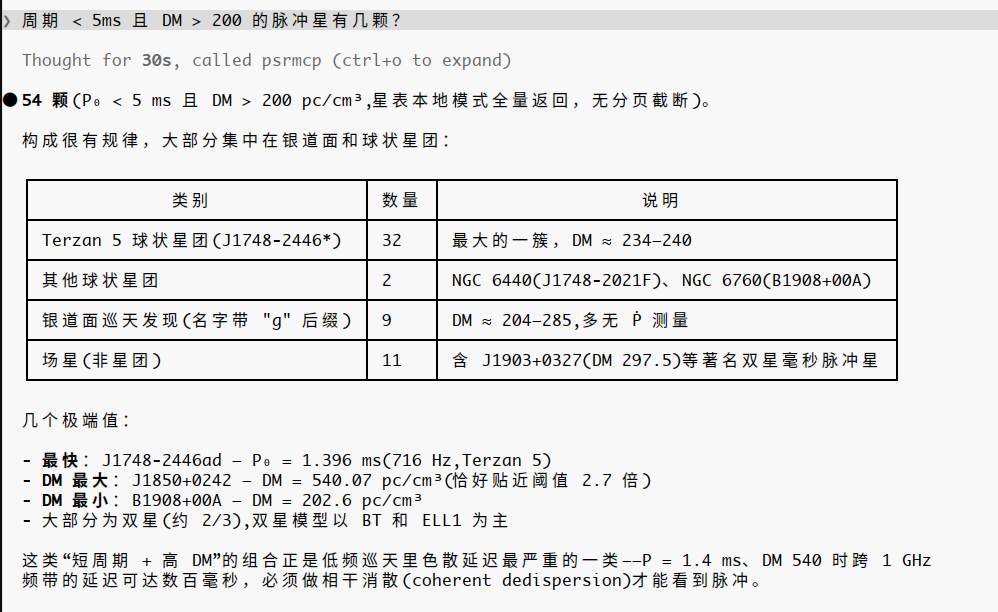

# psrmcp

English | [简体中文](https://github.com/zhangyazhou416/psrmcp/blob/main/README.zh-CN.md)

An MCP (Model Context Protocol) server wrapping the pulsar astronomy software stack (dspsr / psrchive / tempo2 / psrcat / PINT): task-oriented tools, controlled parameters, structured results, and full provenance.

Repositories: <https://gitlab.com/zhangyazhou416/psrmcp> · <https://github.com/zhangyazhou416/psrmcp>

- Overview: [docs/FEATURES.md](https://github.com/zhangyazhou416/psrmcp/blob/main/docs/FEATURES.md) (what it does, all 23 tools)
- Tutorial: [docs/TUTORIAL.md](https://github.com/zhangyazhou416/psrmcp/blob/main/docs/TUTORIAL.md) (setup, MCP clients, a full processing-chain walkthrough)
- Design: [docs/DESIGN.md](https://github.com/zhangyazhou416/psrmcp/blob/main/docs/DESIGN.md)
- Tool contracts: [docs/TOOLS.md](https://github.com/zhangyazhou416/psrmcp/blob/main/docs/TOOLS.md) (input/output schemas for all 23 tools)
- One-click software stack installer: [scripts/install_pulsar_stack.sh](https://github.com/zhangyazhou416/psrmcp/blob/main/scripts/install_pulsar_stack.sh) (builds everything into `~/.pulsar`, see [docs/INSTALL.md](https://github.com/zhangyazhou416/psrmcp/blob/main/docs/INSTALL.md))
- Chinese versions of all five docs live alongside as `docs/*-zh.md`

## Why psrmcp?

Same question — *"How many pulsars have P < 5 ms and DM > 200 pc cm⁻³?"* — asked to a general-purpose LLM with web search, and to Claude Code connected to psrmcp:

| | General LLM (web search) | Claude Code + psrmcp |
|---|---|---|
| Answer | "no exact number available" — and a suggestion to go query the ATNF catalogue yourself | **54** — computed from the local catalogue, full result set, no truncation |
| Basis | Anecdotes scattered across papers and web pages | A live catalogue query executed at answer time |
| Follow-up value | — | Breakdown by population (32 in Terzan 5, 9 from galactic-plane surveys…), extremes (fastest 1.4 ms, DM up to 540), astrophysical interpretation |

| General LLM (web search) | Claude Code + psrmcp |
|:---:|:---:|
|  |  |

The difference is not model intelligence — it is **where the answer comes from**: recalled from training data (frozen, unverifiable, wrong for anything off the beaten track) versus computed from the live catalogue through a contract-tested tool, with the domain CLI knowledge (flags, column names, file formats) already encoded.

## Quick start

### Install from PyPI

```bash
pip install psrmcp        # library + the psrmcp CLI entry point
# standalone CLI instead: uv tool install psrmcp  /  pipx install psrmcp

psrmcp --init-config ~/.psrmcp.toml
PSRMCP_CONFIG=~/.psrmcp.toml psrmcp
```

The pulsar software stack is installed separately (below); without it the server still starts and reports missing backends.

### Run from source

```bash
# 1. Install the pulsar software stack (optional; without it the server degrades
#    gracefully and reports each missing backend via pulsar_environment)
bash scripts/install_pulsar_stack.sh          # add --with-presto to also build PRESTO

# 2. Set up the MCP server environment
uv sync

# 3. Generate a default config and start (stdio)
uv run psrmcp --init-config ~/.psrmcp.toml
PSRMCP_CONFIG=~/.psrmcp.toml uv run psrmcp
```

### Connect an MCP client (e.g. Claude Code / Claude Desktop)

```json
{
  "mcpServers": {
    "psrmcp": {
      "command": "uv",
      "args": ["--directory", "/path/to/psrmcp", "run", "psrmcp"],
      "env": {"PSRMCP_CONFIG": "~/.psrmcp.toml"}
    }
  }
}
```

Installed from PyPI, the entry point is simply `"command": "psrmcp"`.

## Development

```bash
uv run pytest -q                                  # unit tests (no backends required)
PSRMCP_CONTRACT=1 uv run pytest tests/contract    # contract tests (needs the installed stack)
```

## Publishing to PyPI

Automatic via CI (PyPI Trusted Publishing / OIDC — no long-lived tokens): [.github/workflows/publish.yml](https://github.com/zhangyazhou416/psrmcp/blob/main/.github/workflows/publish.yml) is the primary channel, [.gitlab-ci.yml](https://github.com/zhangyazhou416/psrmcp/blob/main/.gitlab-ci.yml) kept as a fallback.

```bash
git tag v0.1.0 && git push origin v0.1.0    # a tag triggers build & upload (keep tag in sync with version)
```

One-time setup: register a pending publisher on pypi.org (Owner `zhangyazhou416`, Repository `psrmcp`, Workflow `publish.yml`) — see the workflow file header for details. Manual publishing: `uv build && uv publish`.

## Status

v0.1.0 — MVP (Phase 0–2): environment introspection, data discovery, catalog queries, archive inspect/convert/merge, dedispersion, RFI, standard profiles, TOA extraction, PINT timing fits and diagnostics.

## License

[MIT](https://github.com/zhangyazhou416/psrmcp/blob/main/LICENSE)
