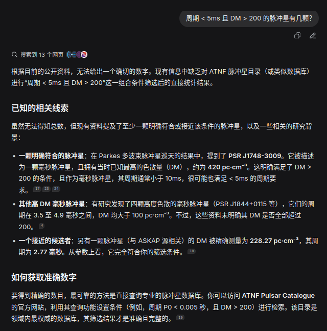
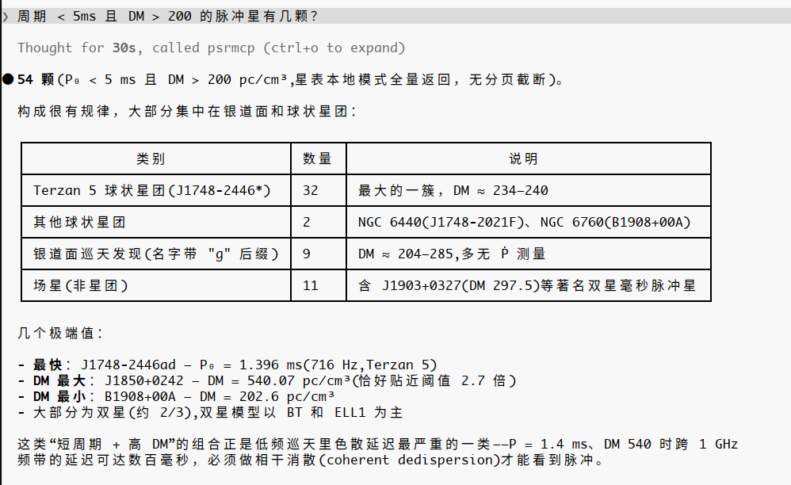

# psrmcp

[English](README.md) | 简体中文

把脉冲星天文软件链(dspsr / psrchive / tempo2 / psrcat / PINT)封装成 MCP(Model Context Protocol)Server:面向任务的工具、参数受控、结果结构化、全程可追溯。

仓库:<https://gitlab.com/zhangyazhou416/psrmcp>
仓库:<https://github.com/zhangyazhou416/psrmcp>

- 功能总览:[docs/FEATURES-zh.md](docs/FEATURES-zh.md)(能做什么、19 个工具一览)
- 使用教程:[docs/TUTORIAL-zh.md](docs/TUTORIAL-zh.md)(安装配置、接入客户端、完整处理链实战)
- 设计方案:[docs/DESIGN-zh.md](docs/DESIGN-zh.md)
- 工具契约:[docs/TOOLS-zh.md](docs/TOOLS-zh.md)(19 个工具的输入/输出 Schema)
- 一键安装脉冲星软件栈:[scripts/install_pulsar_stack.sh](scripts/install_pulsar_stack.sh)(全源码编译进 `~/.pulsar`,详见 [docs/INSTALL-zh.md](docs/INSTALL-zh.md))

## 为什么需要 psrmcp?

同一个问题——「*周期 < 5ms 且 DM > 200 的脉冲星有几颗?*」——分别问带联网搜索的通用大模型,和接入 psrmcp 的 Claude Code:

| | 通用大模型(联网搜索) | Claude Code + psrmcp |
|---|---|---|
| 回答 | 「无法给出一个确切的数字」,并建议你自己去查 ATNF 星表 | **54 颗**——本地星表实查,全量返回,无截断 |
| 依据 | 散落在各论文/网页里的零星个例 | 回答时现场执行的星表查询 |
| 后续价值 | — | 按族群分解(Terzan 5 内 32 颗、银道面巡天 9 颗…)、极端值(最快 1.4 ms、DM 最高 540)、天体物理解读 |

| 通用大模型(联网搜索) | Claude Code + psrmcp |
|:---:|:---:|
|  |  |

差别不在模型聪明程度,而在**答案从哪来**:从训练记忆里回忆(冻结、无法核实、冷门对象必错),还是通过契约测试过的工具现场查询真实星表——领域 CLI 知识(旗标、列名、文件格式)已经提前编码在工具层里。

## 快速开始

### 从 PyPI 安装

```bash
pip install psrmcp        # 库 + psrmcp 命令行入口
# 或独立安装 CLI:uv tool install psrmcp / pipx install psrmcp

psrmcp --init-config ~/.psrmcp.toml
PSRMCP_CONFIG=~/.psrmcp.toml psrmcp
```

脉冲星软件栈需单独安装(见下);不装也能启动,服务器会逐后端报告缺失。

### 从源码运行

```bash
# 1. 安装脉冲星软件栈(可选,缺省时服务器会优雅降级并在 pulsar_environment 中报告)
bash scripts/install_pulsar_stack.sh          # 加 --with-presto 连 PRESTO 一起装

# 2. 准备 MCP 服务器环境
uv sync

# 3. 生成默认配置并启动(stdio)
uv run psrmcp --init-config ~/.psrmcp.toml
PSRMCP_CONFIG=~/.psrmcp.toml uv run psrmcp
```

### 接入 MCP 客户端(如 Claude Code / Desktop)

```json
{
  "mcpServers": {
    "psrmcp": {
      "command": "uv",
      "args": ["--directory", "/path/to/psrmcp", "run", "psrmcp"],
      "env": {"PSRMCP_CONFIG": "~/.psrmcp.toml"}
    }
  }
}
```

从 PyPI 安装后,入口直接写 `"command": "psrmcp"` 即可。

## 开发

```bash
uv run pytest -q                        # 单元测试(不需要安装任何后端)
PSRMCP_CONTRACT=1 uv run pytest tests/contract   # 契约测试(需要已安装软件栈)
```

## 发布到 PyPI

CI 自动发布(PyPI Trusted Publishing / OIDC,CI 中无长期凭据):主通道为 [.github/workflows/publish.yml](.github/workflows/publish.yml),[.gitlab-ci.yml](.gitlab-ci.yml) 备用。

```bash
git tag v0.1.0 && git push origin v0.1.0    # 打 tag 即构建并上传(tag 与 version 保持一致)
```

首次发布前需在 pypi.org 登记 pending publisher(Owner `zhangyazhou416`、Repository `psrmcp`、Workflow `publish.yml`),见 workflow 文件顶部注释。手动发布:`uv build && uv publish`。

## 状态

v0.1.0 — MVP(Phase 0–2):环境自检、数据发现、星表查询、archive 检查/转换/合并、消色散、RFI、标准轮廓、TOA、PINT 计时拟合与诊断。

## 许可

[MIT](LICENSE)
